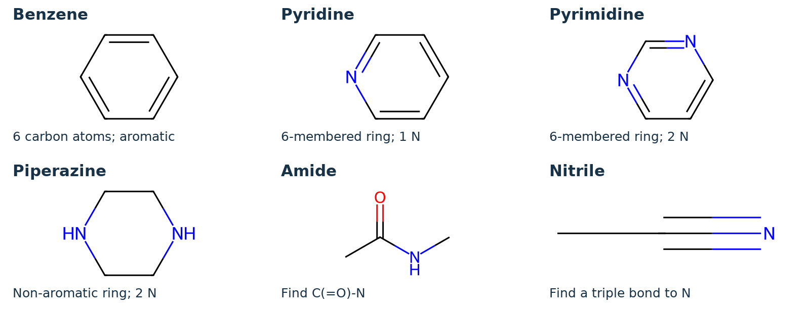

# 1 · Learn the drawing language

## Executive Summary

**Learn the landmarks before memorizing the whole molecule.** These four established medicines inhibit BCR–ABL, a protein involved in certain leukemias. This guide teaches their **existing structures**, not new AI-designed drugs. “Dositinib” is interpreted as **dasatinib**, as confirmed. [3–7]

## Five rules for reading a skeletal structure

1. **An unlabeled corner or line end is carbon.** Hydrogens attached to carbon are usually omitted; ordinary neutral carbon normally has four bonds in total.
2. **One, two or three lines mean a single, double or triple bond.** A double bond counts twice toward carbon’s usual four bonds.
3. **Letters identify other atoms:** N = nitrogen, O = oxygen, S = sulfur, F = fluorine and Cl = chlorine. Cl is one atom symbol, not C followed by a letter I.
4. **A polygon is a ring, but not every ring is aromatic.** Alternating bonds are a common way to draw an aromatic ring; its electrons are delocalized. Piperazine is non-aromatic.
5. **A 2D drawing shows connections, not the molecule’s exact 3D pose.** Rotating a drawing does not change its identity.

{width=100%}

**Highlight key:** A / pale blue = selected nitrogen-containing aromatic rings; B / pale orange = amide, or nitrile for bosutinib; C / pale purple = piperazine; D / pale pink = a distinctive feature. Highlights are **recognition aids**, not a map of measured protein contacts. Atom letters and the labels—not color alone—carry the information.

\newpage

# 2 · Imatinib mesylate

## First recognize the imatinib molecule

![Imatinib, shown as the neutral parent for learning connectivity. The mesylate counterion is not part of this drawing. Sources: PubChem CID 5291 and ChEBI:45783. [1,2]](figures/bcr-abl-inhibitors-fig02-imatinib.png){width=100%}

### Read it in four chunks

- **A · Pyridine + pyrimidine:** find the two aromatic six-membered rings containing nitrogen. Pyridine has **one ring N**; pyrimidine has **two ring Ns**. They are connected rings, not fused rings.
- **Two benzene rings:** the remaining aromatic six-membered rings have only carbon in their ring skeletons. Substituents branch from them.
- **B · One amide:** locate **C(=O)–NH**. The carbonyl is C=O; the adjacent nitrogen makes this group an amide, rather than a ketone.
- **C · Piperazine:** find the non-aromatic six-membered ring with **two opposite nitrogens**. One N carries a methyl group; the other connects through a methylene group, –CH₂–, to a benzene ring. [1,2]

**Memory cue:** “Imatinib = nitrogen-ring pair + amide bridge + piperazine tail.” This is a recognition mnemonic, not a binding model.

## What does “mesylate” add?

**Mesylate means methanesulfonate, CH₃SO₃⁻.** Imatinib mesylate is a salt: a protonated imatinib ion is accompanied by the negatively charged mesylate counterion. A simplified bookkeeping expression is:

$$
\mathrm{[imatinib+H]^+}\quad+\quad\mathrm{CH_3SO_3^-}
$$

This is **not a synthesis reaction**. There is no covalent bond joining mesylate to imatinib. The neutral drawing above makes comparison easier; it does not specify the drug’s protonation at every pH. Gleevec is labeled as imatinib mesylate. [3]

**Check yourself:** Is the sulfur in “imatinib mesylate” inside the imatinib parent? **No—it is in the counterion.**

\newpage

# 3 · Nilotinib

## Start with the familiar, then spot the differences

![Nilotinib, shown as the neutral parent without hydrochloride or water of crystallization. Sources: PubChem CID 644241 and ChEBI:52172. [1,2]](figures/bcr-abl-inhibitors-fig03-nilotinib.png){width=100%}

### Read it in four chunks

- **A · Familiar six-membered N rings:** nilotinib also contains a **pyridine–pyrimidine pair**. Use these as your first landmark when comparing it with imatinib.
- **B · An amide, but check its direction:** follow the connected atoms, not just the overall shape. In imatinib, the benzene on the pyrimidine side connects to the amide **N**. In nilotinib, the corresponding side connects to the **carbonyl carbon**. The two molecules are not identical scaffolds with a tail simply swapped.
- **A · A five-membered imidazole ring:** this aromatic ring contains **two nitrogens**. Do not confuse it with six-membered, non-aromatic piperazine.
- **D · A trifluoromethyl group:** one carbon carries **three fluorine atoms**, written CF₃. It attaches to a benzene ring. Those fluorines are covalently part of nilotinib, not counterions. [1,2]

**Memory cue:** “Nilotinib = familiar N-ring pair, plus imidazole and three Fs.”

## What is absent matters too

**Nilotinib has no piperazine ring.** That gives a fast way to distinguish it from the other three drugs in this guide. It also has no sulfur atom and no covalently attached chlorine in the parent structure. [1,2]

The named product **Tasigna** contains nilotinib as **monohydrochloride monohydrate**: a salt form with one water molecule per formula unit in the crystal. The parent diagram deliberately leaves out the hydrochloride component and crystal water. Other products can differ in formulation; do not assume every product uses the same solid form. [4]

**Check yourself:** Do the three F labels mean three separate fluorine-containing rings? **No—three F atoms are attached to a single carbon.**

\newpage

# 4 · Dasatinib

## Look for sulfur in the drug itself

![Dasatinib, shown as the neutral anhydrous parent. Sources: PubChem CID 3062316 and ChEBI:49375. [1,2]](figures/bcr-abl-inhibitors-fig04-dasatinib.png){width=100%}

### Read it in five chunks

- **D · Thiazole:** find the five-membered aromatic ring containing **one sulfur and one nitrogen**. This is dasatinib’s most useful landmark here. Unlike imatinib mesylate’s counterion sulfur, this S is part of the parent drug.
- **B · Amide:** locate **C(=O)–NH** between the thiazole-containing part and a benzene ring.
- **A · Pyrimidine:** locate the six-membered aromatic ring with **two nitrogens**. The extra N atoms outside the ring are not counted when naming the ring.
- **C · Piperazine and its hydroxyethyl branch:** the non-aromatic two-N ring carries an **–CH₂–CH₂–OH** branch. The final OH is an **alcohol**; it is not the carbonyl oxygen of the amide.
- **Chlorinated benzene:** find the **Cl** directly bonded to a carbon of the benzene ring. A methyl branch is also attached to this ring. This chlorine belongs to the drug, not a chloride counterion. [1,2]

**Memory cue:** “Dasatinib = S-ring + one Cl + an OH-ended side chain.”

## Keep similar-looking names apart

**Thiazole** has five ring atoms, including N and S. **Pyrimidine** has six ring atoms, including two Ns. **Piperazine** also has six ring atoms and two Ns, but it is **non-aromatic**. Ring size and bond pattern help you tell them apart without memorizing the whole molecule.

Dasatinib can be encountered as a **monohydrate**; the ChEBI record distinguishes anhydrous dasatinib from its hydrated form. This page shows only the anhydrous parent, not crystal water. Water of crystallization is not a new OH branch bonded to the drug. [2,5]

**Check yourself:** Can you find both oxygen atoms? **One is in the amide carbonyl; the other is in the terminal alcohol.** [1,2]

\newpage

# 5 · Bosutinib

## Find the fused core and the triple bond

![Bosutinib, shown as the neutral anhydrous parent. Sources: PubChem CID 5328940 and ChEBI:39112. [1,2]](figures/bcr-abl-inhibitors-fig05-bosutinib.png){width=100%}

### Read it in five chunks

- **A · Quinoline core:** two aromatic six-membered rings share an edge—**two atoms and the bond between them**. Together, one benzene-like ring and one N-containing ring make quinoline. This is a **fused** system, unlike imatinib’s linked pyridine and pyrimidine.
- **B · Nitrile:** find **–C≡N** extending from the core. The three lines indicate a triple bond. The nitrogen at the end is not part of a ring.
- **C · Piperazine tail:** the two-N non-aromatic ring connects to the core through **–O–CH₂–CH₂–CH₂–**. Count three carbon atoms between the ether oxygen and the ring nitrogen.
- **Two methoxy groups:** each is **–O–CH₃**. One attaches to the quinoline region and one to the separate benzene ring. Together with the side-chain ether, these account for its three oxygen atoms.
- **Two chlorines:** both Cl atoms are covalently attached to the separate benzene ring. An NH links that ring to the quinoline core. [1,2]

**Memory cue:** “Bosutinib = fused core + nitrile + two Cls.”

## The important contrast: no amide

**Bosutinib has no C(=O)–N amide group.** Its oxygen atoms are in ethers. The NH bridge between aromatic systems is an amine linkage, not an amide, because there is no adjacent carbonyl. This distinction is more informative than simply counting Ns and Os. [1,2]

The named product **Bosulif** contains bosutinib **monohydrate**. Its crystal water is omitted from this anhydrous parent drawing. A hydrate contains associated water; that does not mean water is covalently added to the quinoline skeleton. [6]

**Check yourself:** Does the N at the end of the triple bond increase the number of nitrogen atoms *inside* quinoline? **No—it is outside the ring.**

\newpage

# 6 · Compare the structures, then the mechanism

## Table 1 · Recognition checklist

This table summarizes the verified **neutral parents**, not salts or hydrates. Counts describe connectivity, not potency. [1,2]

| Feature | Imatinib | Nilotinib | Dasatinib | Bosutinib |
|:--|:--|:--|:--|:--|
| Piperazine ring | Yes | **No** | Yes | Yes |
| Amide | Yes | Yes | Yes | **No** |
| Standout feature | Linked pyridine + pyrimidine | CF₃ + imidazole | N/S thiazole + OH | Fused quinoline + nitrile |
| Covalent halogens | None | 3 F | 1 Cl | 2 Cl |
| S in parent | No | No | **Yes** | No |

**Fast identification:** Three Fs? Think nilotinib. A five-membered S ring? Dasatinib. A fused quinoline with C≡N? Bosutinib. A pyridine–pyrimidine pair, amide and piperazine with no halogens? Imatinib. These cues distinguish **these four structures**, not every drug ever made.

## How do different structures block BCR–ABL?

**BCR–ABL is a fusion protein with a kinase “engine.”** A kinase transfers phosphate from ATP to a target molecule. In BCR–ABL, abnormally persistent kinase activity can drive leukemia-associated signaling. These four drugs bind in the ATP-site region and inhibit that activity. [7]

A useful simplified sequence is:

**Drug occupies the ATP-site region → kinase activity is reduced → downstream growth signaling is reduced.** [7]

The different rings and substituents place atoms in different positions in three dimensions. Nitrogen and oxygen atoms can participate in hydrogen bonding **when their bonding state and environment allow it**; carbon-rich aromatic surfaces can make other contacts. Some nitrogens cannot accept a hydrogen bond—for example, an amide nitrogen is generally not an acceptor. Actual binding depends on the whole ligand, the protein’s conformation, water and protonation. [7]

## What a drawing cannot tell you

You cannot rank **clinical effectiveness, safety, mutation coverage, absorption or solubility** by counting rings, fluorines or nitrogens. Nor does a colored region prove that it contacts a particular protein residue. These require structural, biochemical and clinical evidence. BCR–ABL inhibitors can differ in their other protein targets as well. This is a structure-learning guide, not a treatment-selection tool. [3–7]

\newpage

# 7 · Make it stick

## Mini-glossary

| Word | Plain-language meaning |
|:--|:--|
| Parent structure | The drug molecule considered separately from counterions or crystal water. Here, neutral parents are drawn. |
| Heteroatom | An atom other than carbon or hydrogen; here, examples include N, O and S. |
| Aromatic ring | A cyclic system with delocalized electrons; not simply “any hexagon.” |
| Amide | A carbonyl directly attached to nitrogen: C(=O)–N. |
| Ether / alcohol | Ether: C–O–C. Alcohol: C–OH, where the carbon is not a carbonyl carbon. |
| Counterion / hydrate | An oppositely charged ion in a salt / a solid form containing water. |

## Self-check: cover the answers first

1. At an unlabeled corner of a skeletal drawing, which element is implied?
2. Which of these four parent drugs has no piperazine ring? What two landmarks help identify it?
3. Which parent drug contains sulfur? Why does “imatinib mesylate” not contradict that answer?
4. What distinguishes an amide from an ether? Which drug here has a nitrile but no amide?
5. How do fused rings differ from rings joined by a single bond?
6. Can you infer the best medicine for a patient from this table? Why or why not?

### Answers

**1.** Carbon; carbon-bound hydrogens are usually omitted. **2.** Nilotinib: CF₃ and an imidazole ring. **3.** Dasatinib; imatinib mesylate’s sulfur is in the separate mesylate counterion. **4.** Amide = C(=O)–N; ether = C–O–C. Bosutinib has a nitrile and no amide. **5.** The fused rings here share two adjacent atoms and a bond; singly linked rings do not share ring atoms. **6.** No. Patient factors, disease characteristics, efficacy and safety evidence are not contained in a 2D drawing. [1–7]

## Recommendations · A five-minute study routine

**Minute 1:** Name the atom letters. **Minute 2:** Circle the rings and count ring Ns. **Minute 3:** Locate amide or nitrile. **Minute 4:** Identify the signature group and distinguish parent from salt/hydrate. **Minute 5:** Close the guide and explain each drug using its memory cue. Repeat later from memory rather than only rereading.

**Scope reminder:** AI assisted the organization and explanations. The established molecules were not newly AI-designed, and the chemical drawings were rendered deterministically from verified database structures. Educational use only; not prescribing advice.

\newpage

# 8 · References and structure provenance

## Authoritative chemical records

**[1] PubChem, U.S. National Library of Medicine.** Parent compound records: [imatinib, CID 5291](https://pubchem.ncbi.nlm.nih.gov/compound/5291); [nilotinib, CID 644241](https://pubchem.ncbi.nlm.nih.gov/compound/644241); [dasatinib, CID 3062316](https://pubchem.ncbi.nlm.nih.gov/compound/3062316); [bosutinib, CID 5328940](https://pubchem.ncbi.nlm.nih.gov/compound/5328940). Connectivity SMILES, molecular formulas and InChIKeys retrieved through PUG-REST. Accessed 19 October 2026.

**[2] ChEBI, EMBL-EBI.** Independent cross-check records: [imatinib, CHEBI:45783](https://www.ebi.ac.uk/chebi/CHEBI:45783); [nilotinib, CHEBI:52172](https://www.ebi.ac.uk/chebi/CHEBI:52172); [dasatinib (anhydrous), CHEBI:49375](https://www.ebi.ac.uk/chebi/CHEBI:49375); [bosutinib, CHEBI:39112](https://www.ebi.ac.uk/chebi/CHEBI:39112). Accessed 19 October 2026.

## Named product labels

DailyMed labels describe **particular products**; formulation examples are not claims about every brand or generic.

**[3] DailyMed.** [Gleevec—imatinib mesylate tablet](https://dailymed.nlm.nih.gov/dailymed/lookup.cfm?setid=211ef2da-2868-4a77-8055-1cb2cd78e24b). Section 11, Description; section 12.1, Mechanism of Action.

**[4] DailyMed.** [Tasigna—nilotinib capsule](https://dailymed.nlm.nih.gov/dailymed/lookup.cfm?setid=6093952a-5248-45cb-ad17-33716a411146). Section 11, Description: monohydrochloride monohydrate.

**[5] DailyMed.** [Sprycel—dasatinib tablet](https://dailymed.nlm.nih.gov/dailymed/lookup.cfm?setid=4764f37b-c9e6-4ede-bcc2-8a03b7c521df). Description and mechanism; hydrate distinction additionally supported by ChEBI:49375.

**[6] DailyMed.** [Bosulif—bosutinib tablet](https://dailymed.nlm.nih.gov/dailymed/drugInfo.cfm?setid=adc84ad5-a04d-4fee-9ba8-91f7abd928e3). Section 11, Description: monohydrate; section 12.1, Mechanism of Action. Product records accessed 19 October 2026.

## Mechanism background

**[7] Hantschel O, Grebien F, Superti-Furga G.** The growing arsenal of ATP-competitive and allosteric inhibitors of BCR–ABL. *Cancer Research*. 2012;72(19):4890–4895. [doi:10.1158/0008-5472.CAN-12-1276](https://doi.org/10.1158/0008-5472.CAN-12-1276). [Open full text: PMC3517953](https://pmc.ncbi.nlm.nih.gov/articles/PMC3517953/). Used for established mechanism concepts, not a current clinical-treatment ranking.

## How the pictures were checked

PubChem and ChEBI SMILES were parsed using **RDKit 2026.09.1**. For each drug, canonical connectivity agreed, the calculated formula and InChIKey matched the retrieved records, and the drawing contained one neutral parent molecule. Highlights were selected by chemical substructure. The 2D layout is for reading connectivity, not a computed binding pose. Inputs, rendering code and validation results accompany the guide.
